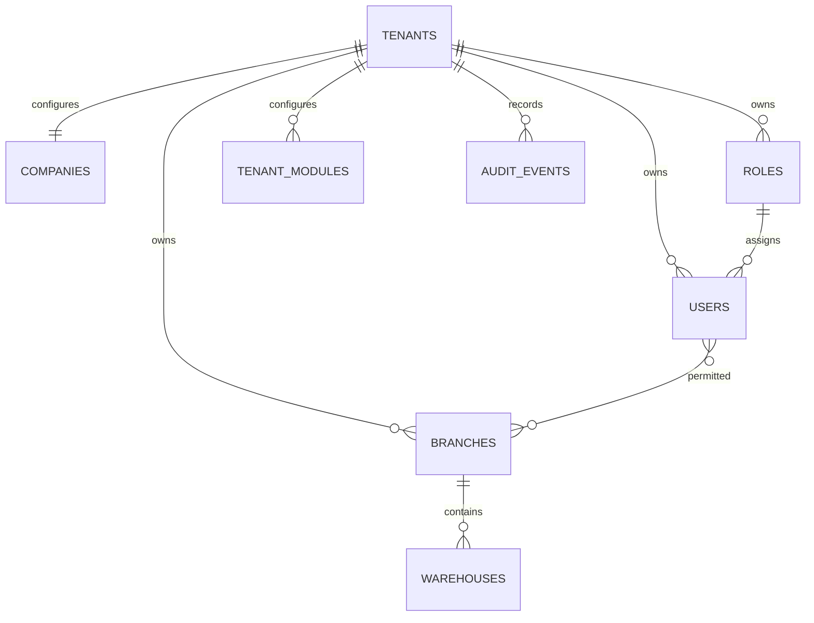

# BRetail foundation architecture

## Scope and decisions

Phase 1 only. Laravel 13 / PHP 8.4.1+, PostgreSQL, React + TypeScript through Inertia, Tailwind, Sanctum API authentication. A modular monolith keeps hosting affordable and transactions local. Services own writes; controllers validate and authorize. Future native clients call the same services through versioned REST endpoints.

Initial layout: `app/Models`, `app/Services`, `app/Http/Controllers`, `app/Http/Middleware`, `config/modules.php`, `resources/js`, `database/migrations`, `tests/Feature`, `docs`. Modules start as registry entries; operational implementations arrive in their scheduled phases. Disabled and unimplemented modules have no operational routes.

## Ownership and database design

Tenant-owned records use non-null tenant IDs. Composite foreign keys enforce same-tenant role and branch ownership. Authenticated tenant context is derived from the user, never a request tenant ID. Global scopes fail closed without a context. Explicit unscoped queries are restricted to onboarding and authentication. Branch policy limits list, view and edit; company-wide permissions are assigned through roles. One company per tenant initially; additional legal entities require a separate company membership boundary before expansion.

Company configuration stores industry, registration, contact, fiscal year, tax and numbering preferences. Currency codes are configurable ISO-style codes; no exchange transactions or statutory calculations exist in Phase 1. Templates store apparel/electronics/general attribute definitions without generating stock.

## Module dependencies

Foundation: dashboard, administration, access, branches and modules. Future inventory depends on branches; POS on inventory, accounting and currencies; purchasing on inventory, accounting and currencies; payroll on HR and accounting; loyalty on sales. Required foundation modules cannot be disabled. Dependency changes are serialized by locking the tenant row and audited in the same transaction. Registry settings do not advertise an unimplemented module as available.

## Integrity and security

Session authentication rotates session IDs at login; logout invalidates the session. Sanctum tokens inherit the user's tenant and permissions. CSRF protects web writes, login is throttled, passwords are hashed, and authorization is server enforced. Audits exclude passwords/tokens. Roles are predefined in Phase 1 to avoid accidental permission escalation. Users may only assign roles they are explicitly authorized to manage.

Future inventory must use an append-only movement ledger, row locking, reservations and reconciliation. Future accounting must enforce balanced immutable postings, period locks and controlled reversals. Use numeric amounts/rates and preserve posting rates. Source transaction idempotency keys must be tenant unique and committed atomically with stock and journal effects. None of these financial workflows is implemented in Phase 1.

## UI concept

Responsive sidebar and mobile drawer; company/branch identity always visible. Dashboard shows real setup counts and readiness, not invented sales metrics. Guided setup configures the first company, branch and warehouse. Branches, team and module screens have working forms and server validation. Optional later modules show their delivery phase without launch buttons.

## Phased checklist

1. Foundation: authentication, atomic onboarding, tenancy, branches, roles, module gates, audit, responsive shell; isolation and permission tests; deployment and user documentation.
2. Inventory: classifications, variants, warehouses, ledger, counts, import and reconciliation tests.
3. POS: shifts, sales, payments, receipts, returns, idempotency and concurrency tests. Financial posting must remain gated until Phase 4 is validated.
4. Accounting: immutable double entry, mappings, periods, routine posting and financial reports.
5. Purchasing/back office: supplier matching, partial receipts/payments, quotations and credit controls.
6. Currency/branches: decimal conversion, exchange differences, transfers and consolidation.
7. HR/payroll: employees, leave, versioned verified statutory packs and payroll posting.
8. PWA/offline/loyalty: device enrollment, controlled sync, integrations and mobile journeys. See [Phase 8 plan](phase-8-plan.md); the installable shell has started, while transactions remain online-only.

Each phase requires passing tests and human review before the next phase starts. PostgreSQL integration tests are required before deployment; SQLite is only a quick isolated test option.

## Phase 2 implementation

The core inventory checklist is now implemented. See [Phase 2 plan](phase-2-plan.md), [report](phase-2-report.md), [API](inventory-api.md) and [user guide](inventory-guide.md). Stock writes use tenant-row serialization, idempotent immutable documents, a movement ledger and derived balances. Counts validate warehouse movement watermarks. The original future-tense Phase 1 sections above document the initial architecture decisions.

## Phase 3 training POS

The core POS workflow is implemented for explicitly enabled local/testing use. See [plan](phase-3-plan.md), [report](phase-3-report.md), [guide](pos-guide.md) and [API](pos-api.md). Live financial checkout stays locked until the Phase 4 adapter and journal tests are validated. Immutable sales/returns, exact decimal allocations, shared tenant locking and composite source constraints keep POS and inventory effects atomic. No accounting engine is claimed.

## Phase 4 accounting update

The Phase 3 training-only boundary above describes the earlier release. Phase 4 adds base-currency accounting, journals, periods, cashbook, supplier invoice posting, bank reconciliation and financial reports. Live POS requires explicit company activation after verified setup; existing training sales are never converted. Read [accounting-guide.md](accounting-guide.md) and [accounting-api.md](accounting-api.md). Payment-provider and fiscal integrations remain outside this release.
